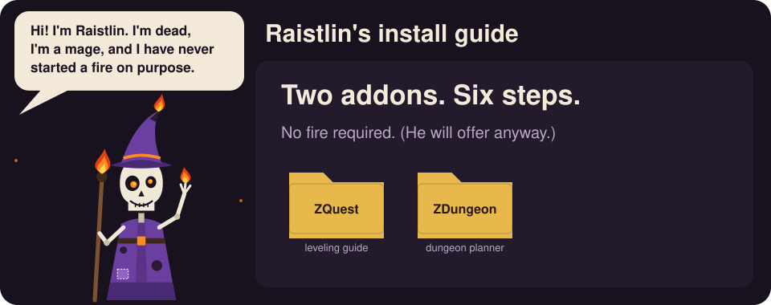
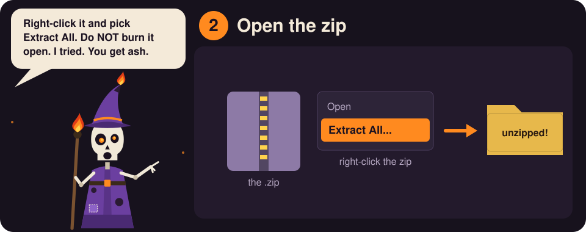
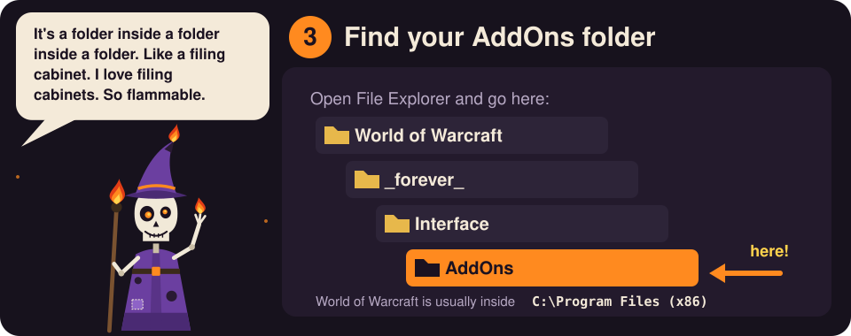
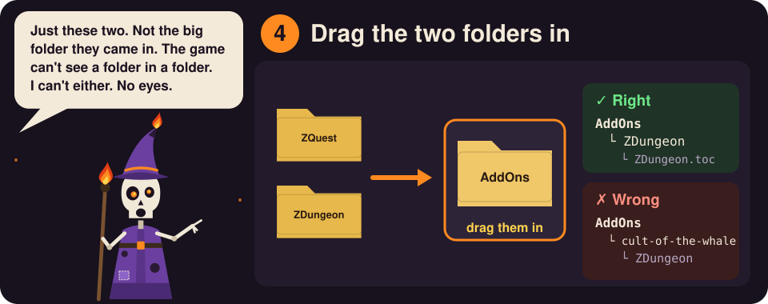
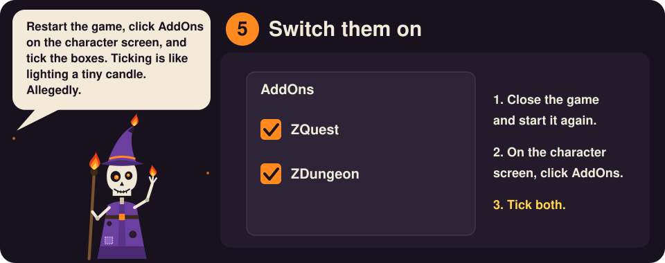
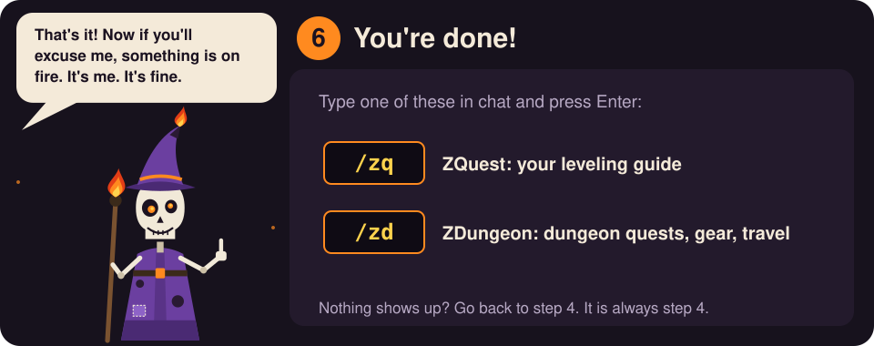

# How to install

Your guide is Raistlin: undead, a mage, and very fond of fire.

## The same thing in words

1. On the [GitHub page](https://github.com/Holmeski/cult-of-the-whale), click the green **Code** button, then **Download ZIP**.
2. Right-click the zip and pick **Extract All**.
3. Open `World of Warcraft\_forever_\Interface\AddOns`. World of Warcraft is usually inside `C:\Program Files (x86)`.
4. Drag the `ZQuest` and `ZDungeon` folders into `AddOns`. Drag the two folders themselves, not the `cult-of-the-whale-main` folder they came in.
5. Restart the game. On the character screen click **AddOns** and tick both.
6. In game, type `/zq` or `/zd`.

You can install just one of them. Each works on its own.

## If nothing shows up

- Open `AddOns\ZDungeon`. You should see `ZDungeon.toc` right there. If you see another folder instead, the addon is one level too deep: move the inner folder up into `AddOns`.
- Make sure the game was fully closed and started again. Reloading the interface does not pick up a new addon.
- On the AddOns screen, tick **Load out of date AddOns** if the addons are greyed out.
