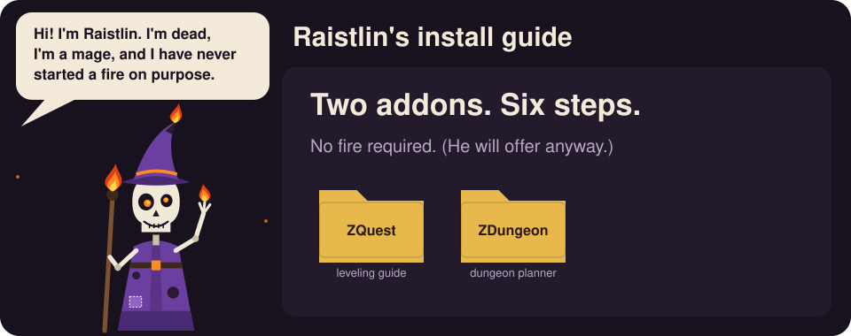

# Cult of the Whale

Addons for World of Warcraft: Forever.

| Addon | What it does | Open with | License |
|---|---|---|---|
| [ZQuest](ZQuest) | Step-by-step leveling guides from 1 to 60 with an arrow, map pins, dungeon walkthroughs and a Find button that targets and marks the quest giver or mob for your step and says where it is. A fork of OpenXP, which is based on RestedXP Guides. | `/zq` | CC BY-NC-SA 4.0 |
| [ZDungeon](ZDungeon) | Dungeon planner: where to go next, a Dungeons tab on the ZQuest guide card with its arrow and waypoints, role-by-role deep dives, quests and the XP they pay, travel time, gear upgrades, and warnings about quests and items you are missing. | `/zd` | GPL v3 |

Status: early releases. In-game testing is in progress.

## Install

**[Follow Raistlin's picture guide](INSTALL.md)**: six steps, no fire required.

The short version: download the zip from the green **Code** button, unzip it, and copy the `ZQuest` and `ZDungeon` folders into `World of Warcraft\_forever_\Interface\AddOns`. Restart the game and tick them on the AddOns screen.

Each addon works on its own. ZDungeon shows travel routes when ZQuest is installed, and gear and upgrade numbers when DungeonJournal and Forever Leveling BiS are installed.

## Licenses and credit

Each folder is a separate work with its own license.

- **ZQuest** is a modified version of [OpenXP](https://github.com/mjared123/OpenXP), itself a modified version of [RestedXP Guides](https://github.com/RestedXP/RXPGuides). It is free, non-commercial, and shared under the same Creative Commons license. See `ZQuest/NOTICE.md` and `ZQuest/LICENSE`.
- **ZDungeon**'s quest data is generated from [QuestieDB](https://github.com/Questie/QuestieDB) (GPL v3), so ZDungeon is GPL v3. See `ZDungeon/LICENSE`.

Not affiliated with RestedXP, OpenXP, Questie or Blizzard Entertainment.
